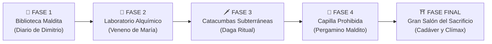

# 🕯️ Pygame: De los Fundamentos al Terror en 2D
### *Colección Didáctica de Pygame y Videojuego Integrador: "El Eco de la Sombra: La Profecía Carmesí"*

[](https://www.python.org/)
[](https://pyga.me/)
[]()
[]()
[](LICENSE)

Este repositorio contiene una colección progresiva de scripts en **Python** diseñados para enseñar el desarrollo de videojuegos 2D con la biblioteca **Pygame**, culminando en un **videojuego hiperrealista de terror psicológico con 5 fases y laberintos explorables, investigación del asesinato de Dimitrio, desenmascaramiento de María y mecánicas de sustos súbitos (*jumpscares*)**.

---

## 📑 Tabla de Contenidos
1. [Estructura del Repositorio](#-estructura-del-repositorio)
2. [Descripción de Archivos Didácticos (01 al 06)](#-descripción-de-archivos-didácticos)
3. [🎮 Videojuego: "El Eco de la Sombra: La Profecía Carmesí" (07)](#-videojuego-el-eco-de-la-sombra-la-profecía-carmesí)
   - [El Sistema de 5 Fases y Laberintos](#el-sistema-de-5-fases-y-laberintos)
   - [Trama: El Asesinato de Dimitrio y la Sospechosa María](#trama-el-asesinato-de-dimitrio-y-la-sospechosa-maría)
   - [El Personaje Principal: Detective Humano](#el-personaje-principal-detective-humano)
   - [Mecánica de Movimiento en Falso y Jumpscare](#mecánica-de-movimiento-en-falso-y-jumpscare)
   - [El Clímax: Desenmascarando a María y la Profecía](#el-clímax-desenmascarando-a-maría-y-la-profecía)
   - [Controles del Juego](#controles-del-juego)
4. [Instalación y Requisitos](#-instalación-y-requisitos)
5. [Guía para Subir este Repositorio a GitHub](#-guía-para-subir-este-repositorio-a-github)

---

## 📂 Estructura del Repositorio

```text
pygame_misterio_terror/
│
├── 01_ventana_y_bucle.py       # Inicialización, Game Loop y 60 FPS
├── 02_formas_y_colores.py       # Coordenadas, paleta RGB y dibujo geométrico
├── 03_movimiento_teclado.py     # Manejo de eventos, WASD, flechas y física básica
├── 04_superficies_y_texto.py   # Renderizado de texto y simulación de máscara de luz
├── 05_sonido_y_efectos.py       # Generación procedimental de audio con pygame.mixer
├── 06_colisiones_y_objetos.py   # Colisiones Rect, proximidad y gestión de inventario
├── 07_el_eco_de_la_profecia.py  # 🎮 PROYECTO INTEGRADOR: JUEGO MULTI-FASE DE TERROR
│
├── jumpscare.png                # Imagen HD para el susto súbito al cometer movimientos en falso
├── requirements.txt             # Dependencias del proyecto (pygame-ce)
├── .gitignore                   # Exclusión de entornos virtuales y cachés
└── README.md                    # Documentación exhaustiva
```

---

## 📚 Descripción de Archivos Didácticos

* **`01_ventana_y_bucle.py`**: Explica el ciclo de vida del juego (*Game Loop*), la inicialización de módulos, limitación de fotogramas a 60 FPS con `pygame.time.Clock()` y captura del evento de salida `QUIT` y `ESC`.
* **`02_formas_y_colores.py`**: Enseña el sistema cartesiano de coordenadas en pantalla, la definición de colores en tuplas `(R, G, B)` y el uso de primitivas geométricas (`draw.rect`, `draw.circle`, `draw.line`, `draw.polygon`).
* **`03_movimiento_teclado.py`**: Demuestra la lectura continua de teclas con `pygame.key.get_pressed()`, desplazamiento bidireccional suave, aceleración con `Shift` y normalización de vectores para evitar ventajas de velocidad en diagonales.
* **`04_superficies_y_texto.py`**: Aborda el renderizado de tipografías con `pygame.font` y el uso de superficies con canal alfa (`pygame.SRCALPHA`) para recortar luz en la penumbra.
* **`05_sonido_y_efectos.py`**: Implementa síntesis matemática de ondas de audio puras (latidos, campanas y drones oscuros) mediante `struct.pack`, sin necesidad de archivos externos.
* **`06_colisiones_y_objetos.py`**: Enseña a detectar colisiones con rectángulos (`colliderect`), calcular proximidad euclidiana e integrar una barra superior de inventario (HUD) con recolección mediante la tecla `E`.

---

## 🎮 Videojuego: "El Eco de la Sombra: La Profecía Carmesí"

El archivo `07_el_eco_de_la_profecia.py` es un proyecto integrador avanzado que traslada al jugador a través de **cinco fases temáticas consecutivas**, cada una con su propio laberinto arquitectónico, ambientación sonora, peligros espectrales y evidencias clave.



---

### El Sistema de 5 Fases y Laberintos

Cada nivel presenta una ambientación visual, textura de muros, piso y densidad laberíntica única:

| Fase | Título y Entorno | Evidencia Forense | Peligros del Laberinto |
| :---: | :--- | :--- | :--- |
| **1** | **La Biblioteca Maldita**: Estanterías altas de caoba con libros antiguos y suelo de parqué oscuro. | 📜 **Diario Rasgado de Dimitrio**: Dimitrio relata que vio a María realizando rituales y diciendo que su sangre era el precio pactado. | Pasillos ciegos, 2 sombras errantes y crujidos en el suelo. |
| **2** | **El Laboratorio Alquímico**: Vitrinas rotas, frascos con vapores verdosos y suelo de losas oscuras. | 🧪 **Frasco de Cicuta con Pañuelo de María**: Veneno paralizante con un pañuelo de seda con monograma `"M"` y aroma a lavanda amarga. | 2 apariciones espectrales rápidas y charcos venenosos. |
| **3** | **Las Catacumbas Subterráneas**: Cripta de piedra gris, telarañas y nichos mortuorios. | 🗡️ **Daga Ritual con el Sello de María**: El arma que atravesó el corazón de Dimitrio, con las huellas de María y su anillo ceremonial. | Dédalo subterráneo estrecho, 2 espectros en patrulla y runas de sangre. |
| **4** | **La Capilla Prohibida**: Columnatas arcanas de basalto con alfombras carmesí y antorchas. | 🔮 **Pergamino de la Profecía Maldita**: El pacto de sangre milenario que María firmó para consagrar el sacrificio del primogénito. | 3 sombras veloces y múltiples esquinas oscuras. |
| **5** | **El Gran Salón del Sacrificio**: El centro de la mansión donde reposa el cadáver de Dimitrio sobre el Altar de los Cuatro Sellos. | ⛩️ **Altar Ceremonial**: Con las 4 evidencias reunidas, se activa el veredicto judicial y el clímax de la profecía. | La confrontación final y el temblor de la maldición desatada. |

---

### Trama: El Asesinato de Dimitrio y la Sospechosa María
Eres un detective convocado de urgencia a la solitaria mansión señorial de la familia Blackwood. **Lord Dimitrio Blackwood** ha sido hallado muerto sobre un círculo ritual en el centro de la residencia, con el corazón atravesado por una daga ceremonial y signos de envenenamiento.

Debes explorar las cuatro alas de la mansión a través de sus laberintos para reunir las pruebas forenses. Toda la evidencia apunta a una sola persona: **María Blackwood**, la consejera y hermana de Dimitrio, quien realizó el crimen a sangre fría.

### El Personaje Principal: Detective Humano
El personaje no es una figura abstracta, sino un **ser humano detallado**:
* Viste una gabardina de detective clásica con hombreras, pliegues y cinturón.
* Lleva un sombrero *fedora* con cinta de cuero dorado.
* Animación realista de pasos: balanceo natural de hombros y brazos.
* Porta en su mano derecha una linterna metálica que proyecta un haz de luz cónico con partículas de polvo flotando en suspensión.

### Mecánica de Movimiento en Falso y Jumpscare
En los estrechos corredores de cada laberinto deambulan **sombras errantes espectrales** y se ocultan **runas de sangre malditas**:
* Si cometes un movimiento en falso (chocar contra un espectro o pisar una trampa en la oscuridad), la pantalla se sacude violentamente (*screen shake*).
* **El Jumpscare**: Se proyecta en primer plano la imagen de un rostro demoníaco gritando (`jumpscare.png`) con efecto estroboscópico de destellos rojos y blancos, acompañado de un **ensordecedor alarido sonoro**.
* El detective es arrojado hacia atrás en estado de shock, con la linterna parpadeando.

### El Clímax: Desenmascarando a María y la Profecía
Al llevar los cuatro artefactos al Altar Central en la Fase 5:
1. **La Resolución del Crimen**: El detective declara el veredicto: **¡MARÍA BLACKWOOD ES LA ASESINA DE DIMITRIO!**
2. **El Giro de Terror y la Maldición**: Justo cuando el caso parece cerrado, el altar tiembla, la linterna se torna de un rojo sangre espectral y las runas despiertan. Se revela la siniestra verdad: **María asesinó a Dimitrio porque la profecía exigía su sangre para romper el sello milenario**. Al reunir las cuatro ofrendas en el altar, el jugador ha completado el ritual y desatado la pesadilla ancestral sobre el mundo.

### Controles del Juego
| Tecla | Acción |
| :--- | :--- |
| `W, A, S, D` / `Flechas` | Desplazar al detective por los laberintos |
| `Shift` (mantener) | Correr (mayor velocidad) |
| `E` o `Espacio` | Recoger evidencias / Entrar al portal de la siguiente fase / Altar / Cerrar notas |
| `F` | Encender o apagar la linterna |
| `R` | Reiniciar el juego (en pantalla final o tras un susto) |
| `ESC` | Salir del juego |

---

## 🛠️ Instalación y Requisitos

```bash
# 1. Clonar el repositorio
git clone https://github.com/TU_USUARIO/NOMBRE_REPOSITORIO.git
cd NOMBRE_REPOSITORIO

# 2. Instalar la librería Pygame
pip install -r requirements.txt

# 3. Iniciar el juego de terror
python 07_el_eco_de_la_profecia.py
```

---

## 🚀 Guía para Subir este Repositorio a GitHub

### Vía Web de GitHub:
1. Crea un repositorio en [GitHub](https://github.com) llamado `pygame-misterio-profecia`.
2. Haz clic en **uploading an existing file**.
3. Arrastra todos los archivos de esta carpeta (incluyendo `jumpscare.png`, los scripts `.py`, `README.md` y `requirements.txt`).
4. Haz clic en **Commit changes**.

### Vía Terminal (Git):
```bash
git init
git add .
git commit -m "feat: juego de terror hiperrealista con 5 fases y laberintos, caso Dimitrio y María, jumpscare y modulos pygame"
git branch -M main
git remote add origin https://github.com/TU_USUARIO/TU_REPOSITORIO.git
git push -u origin main
```
